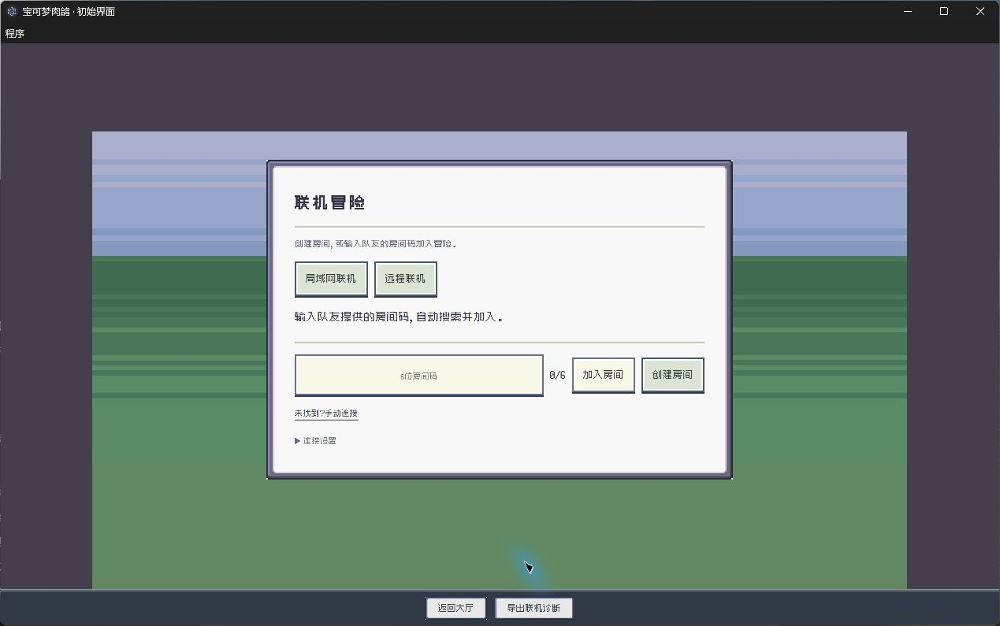

# PokéRogue LAN

原版像素冒险，和朋友一起推进。基于 PokéRogue 历史版本制作的 **Windows 桌面单人／双人合作游戏**，玩家自己开房，本地加载图片、音乐和翻译。

**1.0.0-beta.4 · Windows x64 测试版**

[下载游戏](https://github.com/northstreet01/pokerogue-lan/releases) · [反馈问题](https://github.com/northstreet01/pokerogue-lan/issues) · [更新记录](CHANGELOG.md)

> 这是开发测试版。主要流程已接通，特殊机制、双设备和长局场景尚未完成全面验证。更新前请备份存档，两名玩家请使用相同版本。



## 下载与启动

1. 在 Releases 下载 **PokeRogue-LAN-v1.0.0-beta.4-win32-x64.zip**。GitHub 自动提供的 Source code 是源码，不是游戏运行包。
2. **完整解压** ZIP，运行其中的 **PokeRogue-LAN.exe**。无需安装 Node.js，也无需外部浏览器。
3. 在大厅的“本地档案／存档管理”中创建或选择个人档案，再开始冒险。

请保留 EXE 旁的 `resources`、`locales`、DLL、PAK 等全部文件，不能只复制 EXE。更新时退出旧程序，将新版解压到新文件夹，并保留个人数据目录。

Release 提供 `SHA256SUMS.txt`。在 PowerShell 中运行 `Get-FileHash 下载的ZIP路径 -Algorithm SHA256` 可核对下载文件完整性。

## 和朋友一起玩

### 同一局域网

**房主：**进入“联机冒险 → 局域网联机”，点击“创建房间”。程序自动启动本机房主服务，再创建房间。将六位房间码发给朋友。

**队友：**进入“联机冒险 → 局域网联机”，输入房间码并点击“加入房间”。程序自动查找对应房主，正常情况下无需查询或填写 IP。

**双方：**分别选择队伍，完成选队并提交准备。双方连接与状态确认完成后，一起开始冒险。

搜索不到时，会提示“未找到该房间”并展开手动地址输入。先检查房间码、双方版本和网络，再通过手动入口填写房主地址。访客 Wi-Fi、路由器设备隔离、不同子网或防火墙可能阻止自动发现；网络隔离也可能阻止手动连接。旧版房主不支持新版按房间码发现，需要双方更新。

### 不在同一局域网

选择“远程联机”，填写房主可访问的 IP、域名、`域名:端口` 或 HTTP/HTTPS 地址。需要双方自行配置可直连网络、虚拟局域网或端口映射，游戏不提供自动穿透或中继。

房间码标识房主上的房间，不能代替跨互联网连接所需的地址。不要把虚拟局域网的协调服务器地址当成游戏房主地址。

| 端口 | 用途 |
| --- | --- |
| TCP 18734 | 本机游戏资源，仅监听回环地址 |
| TCP 18735 | 默认房主服务，可在连接设置中修改 |
| UDP 18736 | 局域网房间发现 |

## 合作规则

| 内容 | 合作模式 |
| --- | --- |
| 开局选队 | 每人选择 3 只，共享 14 点预算；同一物种不能跨玩家重复选择 |
| 临时共享 | 新房可共享双方可选图鉴；临时选队权限不会变成永久解锁 |
| 战斗 | 各自控制本人的精灵，通常双方各出场 1 只；房主统一结算共同战斗 |
| 捕获 | 精灵和对应个人成果归成功捕获者 |
| 奖励／商店 | 各自管理队伍、资金和持有物，共享限量库存；双方完成整备后推进 |
| 换人／融合 | 仅操作本人队伍，不能跨玩家融合 |
| 永久成长 | 图鉴、IV、蛋招、成就等成果分别写入本人档案 |
| 恢复冒险 | 使用原房主数据和本人原席位恢复；暂不支持房主迁移 |

新冒险重置本局等级、HP/PP、金钱和持有物，保留原版收藏与解锁语义。这不是永久精灵实例养成仓库。队友先选攻击不会按设计限制另一位玩家投球；蓄力、连续行动和再充能由后续回合自动处理。特殊机制仍可能存在未覆盖问题。

## 存档、退出与蛋

- **返回大厅／临时离开**保留房间和已提交行动，不等于放弃本局。继续需要原房主在线和本人席位。
- **明确放弃本局**按失败处理，可解除旧局与带入蛋的绑定，旧局无法继续时也能主动放弃。
- 新版新房会推进带入蛋的进度。进度完成后等待本局结束，在大厅领取孵化结果。
- 重载不会强制播放孵蛋。已经保存结果的展示可选择继续、跳过或稍后处理；跳过不会重复发奖。

Windows 数据目录为 `%APPDATA%\PokeRogue-LAN`，可从程序菜单打开。

| 数据 | 位置与用途 |
| --- | --- |
| 个人档案 | `storage/personal.sqlite`：收藏、单人进度、偏好和私有联机席位 |
| 个人备份 | `storage/backups/`：程序菜单生成的数据库备份 |
| 房主数据 | `hosts/formal-rooms/`：房主身份、房间和合作检查点 |

更新前建议通过程序菜单备份数据库；复制完整数据目录或房主目录前先退出程序。个人档案与房主房间不能互相替代，恢复合作需要各自对应的数据。不要将数据库、席位凭据或个人数据目录发给朋友当邀请码。

## 卡住时怎么办

1. 先点底栏 **“导出诊断”**保留 JSON。大厅、单人冒险、扭蛋、联机战斗与商店均可使用，不需要浏览器控制台。
2. 尝试底栏 **“重载存档”**恢复最近已保存节点；它不会撤销已确认的购买或重新发放成果。
3. 如果程序完全无响应，重启后在大厅导出此前已保存的记录。
4. 在 Issues 中注明版本、房主／客机、发生阶段、最后一次操作和能否重现。同步问题尽量同时提供双方记录。

诊断保留最近一段本机事件，包括阶段推进、保存失败错误码、档案占用、未捕获异常和联机记录，不包含房间令牌、玩家名称或原始存档，也不等于完整战斗录像。提交前仍请检查文件内容。请勿公开个人数据库、完整存档或恢复凭据；安全问题见 [SECURITY.md](SECURITY.md)。

## 当前限制与已知问题

- 变形后前置进化图鉴形态标记越界导致的保存失败已修正，并完成全形态目录校验；Mega 与超极巨道具同时持有的冲突、动画及其他形态机制仍需单独验证。
- 图图犬四个写生导致选队校验失败已修正；写生的全部战斗组合尚未完成验证。
- 聚宝功按楼层收益暂存金币，在战斗结束时领取；联机金币归使用者所属玩家，双方须使用同一构建版本。
- 特殊招式、道具转移、形态和长局同步仍可能异常；资源释放和菜单优化不代表全部卡死已解决。
- 经典路线当前自动推进；地图道具手动选路、Android 和自动房主迁移暂未完成。

本版完成了多组主机规则、菜单恢复、投球顺序、道具显示、局域网发现及缓存释放的针对性测试。这些检查不代替真实双电脑和长时间游玩验证。

## 从源码构建

需要 **Node.js 24+**、npm，Windows 发行包需在 Windows 环境构建。

```powershell
git clone https://github.com/northstreet01/pokerogue-lan.git
cd pokerogue-lan
git checkout v1.0.0-beta.4
npm ci --ignore-scripts
node node_modules/electron/install.js
npm run build:desktop
npm run package:desktop
```

输出目录：`build/desktop/release/PokeRogue-LAN-win32-x64/`。开发运行用 `npm run start:desktop`。如本机已缓存相应 Electron ZIP，可用 `POKEROGUE_ELECTRON_ZIP_DIR` 指向缓存目录离线打包。

前端开发用 `npm run start`。浏览器合作入口需先运行 `npm run build:coop-runtime`、`npm run build`，再运行 `npm run start:local`；对局域网开放用 `npm run start:local -- --host`。静态 `dist` 不包含完整合作房主服务。

```powershell
npm run review:code
npm run typecheck
npm test
npm run test:desktop
npm run test:local-save
```

规则与联机测试分别使用 `npm run test:battle-core`、`npm run test:coop`。它们会重建共用 Worker，请在同一工作目录中串行运行。完整 CI 状态以 GitHub Actions 为准。

## 实现与来源

客户端保留 Phaser 界面。房主服务协调行动，每个房间通过独立 Node.js Worker 运行原版规则，再发送各自可见的快照和展示事件。个人成长事务、合作检查点和网络回执分别保存；动画不重新决定伤害和随机结果。

桌面端使用 Electron 和 SQLite，渲染器通过受限预加载接口访问个人资料。本机资源服务与局域网房主服务分开运行，没有开发者托管的中央战斗服务器。

本项目基于 [pagefaultgames/pokerogue 历史源码](https://github.com/pagefaultgames/pokerogue/tree/ec9365a8bffd8fa0dc050e71ef3eb177e63bc1e9)，不代表与上游最新版本完全一致。源码遵循 [GNU AGPL-3.0](LICENSE)。Pokémon 及相关素材的权利归各自权利人所有，本项目与其无隶属关系。

部分译文来源见 [翻译来源清单](locales/catalog-sources.json) 和 [PokeAPI 许可文件](public/licenses/pokeapi.txt)。以下保留原素材署名。


# Credits
> If this project contains assets you have produced and you do not see your name here, **please** reach out.

### BGM
  - Pokémon Mystery Dungeon: Explorers of Sky
    - Arata Iiyoshi
    - Hideki Sakamoto
    - Keisuke Ito
    - Ken-ichi Saito
    - Yoshihiro Maeda
  - Pokémon Black/White
    - Go Ichinose
    - Hitomi Sato
    - Shota Kageyama
  - Pokémon Mystery Dungeon: Rescue Team DX
    - Keisuke Ito
    - Arata Iiyoshi
    - Atsuhiro Ishizuna
  - Pokémon Black/White 2

### Sound Effects
  - Pokémon Emerald
  - Pokémon Black/White

### Backgrounds
  - Squip (Paid Commissions)
  - Contributions by Someonealive-QN

### Game Logo
  - Gonstar (Paid Commission)

### Trainer Sprites
  - GAMEFREAK (Pokémon Black/White 2, Pokémon Diamond/Pearl)
  - kyledove
  - Brumirage
  - pkmn_realidea (Paid Commissions)

### Trainer Portraits
  - pkmn_realidea (Paid Commissions)

### Pokemon Sprites
  - GAMEFREAK (Pokémon Black/White 2)
  - Smogon Sprite Project (Various Artists)
  - Skyflyer
  - Nolo33
  - Ebaru
  - EricLostie
  - KingOfThe-X-Roads
  - kiriaura
  - Caruban
  - Sopita_Yorita
  - Azrita
  - AshnixsLaw
  - Hellfire0raptor
  - RetroNC
  - Franark122k
  - OldSoulja
  - PKMarioG
  - ItsYugen
  - lucasomi
  - Pkm Sinfonia
  - Poki Papillon
  - Fleimer_
  - bizcoeindoloro
  - mangalos810
  - Involuntary-Twitch

### Move Animations
  - Pokémon Reborn
